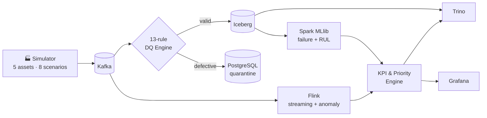

<div align="center">

# ⚙️ ForgeStream

**Real-time industrial asset health monitoring & predictive maintenance**


B.Tech CSE (Sem VII) · Big Data Analytics (CA-3) · Symbiosis Institute of Technology, Pune

</div>

---

## 🏗️ Architecture



## 🧩 Phases

| | Phase | Highlights |
|:-:|---|---|
| 1 | **Data Foundation** | Physics-based simulator · Kafka · 13 DQ rules · Iceberg · Postgres |
| 2 | **Stream Processing** | 5 s watermarks · windows · 3-level anomaly detection · Flink |
| 3 | **Predictive ML** | 25 features · leakage audit · Random Forest · MLflow |
| 4 | **Serving & Analytics** | Dual store · Trino (21 queries) · Grafana (16 panels) |

## 📈 Results

| Metric | Value |
|---|---|
| Failure classifier PR-AUC / Recall | **0.7666 / 0.8512** |
| RUL regressor R² / RMSE | **0.3980 / 30.74 h** |
| Reference run (1,000 events) | **100%** pass rate · 10 snapshots |
| Ingestion throughput | **1,515 events/sec** |
| DQ detection | **100%** across 13 rules |

## 🚀 Quickstart

```bash
git clone https://github.com/MITHLESH55/ForgeStream-Industrial-Analytics.git
cd ForgeStream-Industrial-Analytics
python -m venv .venv && source .venv/bin/activate   # Windows: .venv\Scripts\activate
pip install -r requirements.txt && pip install -e .
cp .env.example .env
```

Optional full stack (Kafka, Postgres, Flink, Trino, Grafana):

```bash
docker compose up -d
```

## 💻 Usage

```bash
python -m forgestream.cli smoke                                   # smoke test
python -m forgestream.cli run --duration 60 --seed 42 --batch-size 50
python -m forgestream.cli verify --limit 10                       # Iceberg snapshots
python scripts/run_phase4_demo.py                                 # serving + Trino demo
pytest tests/ -v                                                  # all tests
```

## 📂 Structure

```text
forgestream/
├── simulator/  kafka/  validation/  iceberg/  postgres/   # Phase 1
├── streaming/                                             # Phase 2
├── ml/                                                    # Phase 3
├── serving/                                               # Phase 4
grafana/   trino/   sql/phase4/   tests/   results/   docs/
```

📎 Evidence: [`docs/report-evidence/`](docs/report-evidence/) · Status: [`PROJECT_STATUS.md`](PROJECT_STATUS.md)

---

<div align="center">

**Author:** MITHLESH YADAV · *From raw telemetry to maintenance decisions.*

</div>
